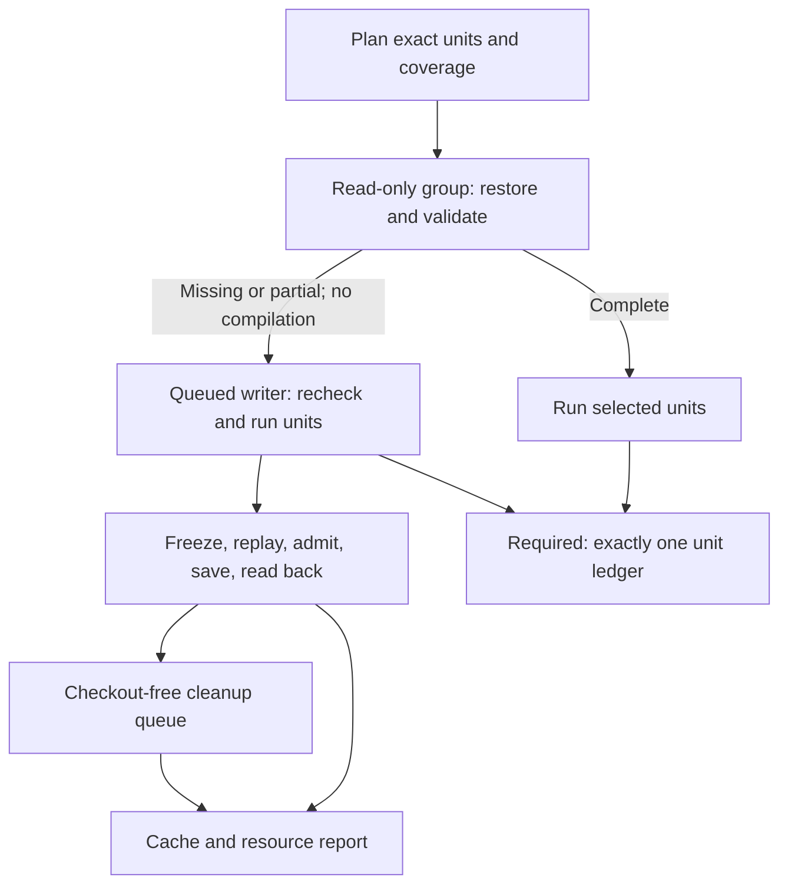
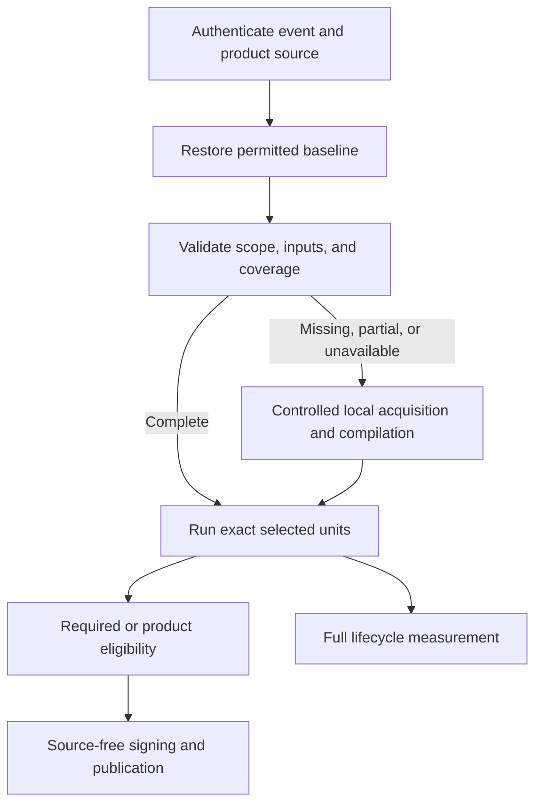
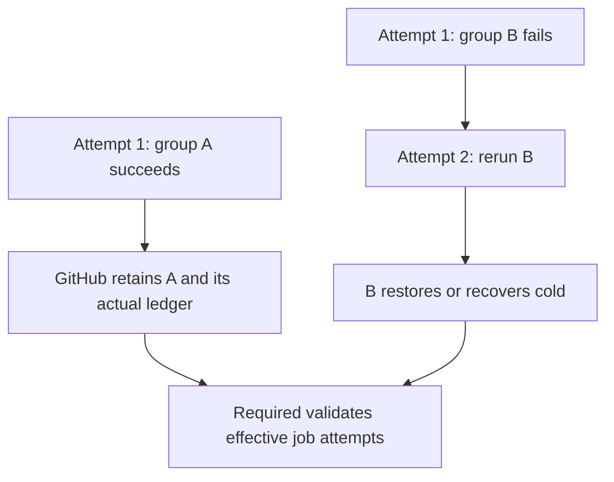

# Event workflows and cache state

The diagrams describe proposed generated behavior. They are not deployed workflows.

## Trusted default branch

Emit static jobs per group. A job-level condition cannot select a matrix child before matrix expansion.
Use explicit read/write cache modes and least-privilege GitHub token permissions.
Writers and cleanup use the same repository concurrency name with `queue: max` and `cancel-in-progress: false`.
Apply that group only to the mutation-owning job. Do not nest the same lock in its caller.
Reader and writer calls have separate explicit capability ceilings.
Required runs with outcome-aware conditions even when the writer skips.

The read-only group validates every required family before consumer commands.
A warm group never starts its writer runner.
The writer executes this run's checks even when another writer warmed the cache while it waited.
It then skips unnecessary publication.
All groups still report every selected unit separately.

Before publication, the writer joins all producer processes and freezes the payload plus manifest.
It records the digest outside the archive, clears only owned target/build and ephemeral MBX directories, then restores those same frozen bytes at identical qualified paths.
Replay uses stable Rust and RUSTDOC adapters with complete applicable native/origin observation and an empty ephemeral MBX store.
It must observe zero unchanged eligible dependency compiler work.
Publish the unchanged frozen bytes, with replay evidence bound to their digest outside the payload.
Do not repack a tree changed by replay and transfer the earlier proof to it.

Execute at the actual checkout, with cache/transport homes outside it in stable owned runner paths.
Restore authenticated unchanged files/subtrees with their original timestamp precision, including nanoseconds and directory metadata where supplied.
Restore directory metadata after its children and only for an authenticated unchanged directory subtree.
Keep current Git metadata, changed/new paths, and changed parent-directory semantics intact.
Do not synthesize timestamps or assume ordinary tar unpack preserved their precision.

## PR, fork PR, merge queue, tag, preview, and stable build

These consumers do not save dependency generations.
They reuse only state visible and authorized under GitHub's event/ref contract.
The action cannot request an inventory cache ID or ref.
Inspect all expected-version candidates the service could select before restoration, including longer primary-key prefix matches when restore-keys is empty.
A default-ref inventory filter alone does not prevent a current-ref exact or prefix shadow.
The pin can extract a differing matched key before returning it; reject unauthorized/ambiguous outer provenance before download and still require returned-key equality afterward.
Inventory preflight does not atomically fence uncontrolled writers.
Decline ambiguous/unavailable provenance and use the permitted cold path; no key or producer-written manifest supplies missing trust.
A PR merge-ref cache cannot become a main cache through a broad key.
New PR dependencies require trusted default preparation after acceptance and merge.
That preparation is explicit measured work.

Signing and publication do not compile application source or restore Cargo state.
Keep the current independent product and source verification rules.
Use fixed data-only authority operations for image validation and publication.
Render fixed trusted Python/gh/OCI code adapted from the existing `candidate.py` and `publish.py` algorithms.
Preserve their current authenticated GitHub checks and product-upload destinations.
No new helper API, release prerequisite, protocol, action, tool, or pin is required for this authority change.
Do not execute candidate code or repository scripts in those jobs.

## Initial and growing production coverage

The default plan enumerates existing CI, named-check, helper, native, preview, and stable recipes.
It uses current production configuration and source-defined release command builders.
It does not derive production recipes from the crate CI manifest alone.
It prepares missing supported production variants through credential-free build commands.
It does not sign or publish products to warm a cache.
Current source-only changes reuse the existing generation.
Current dependency changes create only the required new compatible generation.

## Failed-job reruns

Keep each job's actual attempt and job ID.
Accept A's earlier ledger only when authenticated GitHub records show that A was retained without rerunning.
Require a new result for B. Do not relabel A as attempt 2 execution.
Never assume a previously successful producer's filesystem survives.

## Publication and recovery states

```mermaid
stateDiagram-v2
  [*] --> Discover
  Discover --> Restore
  Restore --> Complete: valid complete state
  Restore --> Partial: useful incomplete state
  Restore --> Missing: no entry
  Restore --> Unavailable: service or access failure
  Restore --> Corrupt: verified invalid bytes
  Complete --> Checks
  Partial --> Recovery
  Missing --> Recovery
  Unavailable --> Recovery
  Corrupt --> Recovery
  Recovery --> Checks: read-only event
  Recovery --> WriterQueue: trusted default event
  WriterQueue --> Recheck
  Recheck --> Checks: already complete
  Recheck --> Produce: missing coverage
  Produce --> Freeze
  Freeze --> RestoreFrozen
  RestoreFrozen --> Replay: same paths; empty MBX store
  Replay --> Admit: complete observed closure
  Replay --> Unqualified: repeated dependency work or missing evidence
  Admit --> Save: budget and disk pass
  Admit --> CapacityBlocked: insufficient or unknown headroom
  Save --> Readback
  Save --> Unpublished: denied or interrupted
  Readback --> Published: exact bytes and manifest verified
  Readback --> Unverified: timeout or unknown result
  Readback --> CorruptCandidate: reproducibly invalid payload
  Published --> CleanupQueue
  CorruptCandidate --> RepairReview
  RepairReview --> RepairCleanupQueue
  RepairCleanupQueue --> RecheckRepair
  RecheckRepair --> DeleteBadCandidate: exact owned bad ID; usable predecessor; active repair intent
  RecheckRepair --> Retain: evidence missing or intent stale
  DeleteBadCandidate --> Report: deletion confirmed before repair admission
  CleanupQueue --> RecheckIntent
  RecheckIntent --> Retire: replacement remains valid and active
  RecheckIntent --> Retain: stale or unavailable evidence
  Retire --> Report
  Retain --> Report
  Checks --> Report
  CapacityBlocked --> Report
  Unpublished --> Report
  Unverified --> Report
  Unqualified --> Report
```

A normal optional cache failure inside a running worker does not suppress its checks.
A hard failed or cancelled worker cannot run remaining units after it terminates.
Required then fails with explicit missing/failed results. An authorized rerun can recover.
Do not add a hidden rescue workflow or call the unfinished units successful.

An unverified candidate still consumes bytes and a generation slot.
A timeout alone does not authorize deleting it as corrupt.
Recheck and validate it later, or use the reviewed exact-ID corruption repair path.
Retain the usable predecessor until replacement or corrupt-candidate handling is verified.

## Mutation guards and final evidence

The compiling writer has cache-write capability and only necessary GitHub token read permissions.
Only checkout-free cleanup receives Actions write for exact owned deletion; cache mode is none there.
Send verified replacement tuples and exact proposed predecessor IDs through existing report/control metadata, never cache bytes through artifacts.
Cleanup reacquires the repository queue and rechecks presence, ownership, ref/version, and active intent.
It cannot assume adjacency to its writer, and later writers charge both generations until deletion is confirmed.

Current intent means currently desired compatibility and coverage, not newest creation time or unconditional equality of default HEAD.
If HEAD moved, recompute relevant identity using existing pure planning code without executing its tasks.
An application-only move can leave coverage active.
Unavailable or retired intent skips optional publication/deletion while required checks retain their normal result path.
The corruption branch also requires reproducible invalidity and a reviewed repair record; a timeout is not that evidence.

The qualification harness produces the concrete approved run-command manifest before hosted tasks execute.
Live task macros are blocked command contracts until that manifest resolves their repository, candidate, events, cases, limits, faults, collection, and cleanup authority.
This planning document does not authorize dispatch or mutation.

Final regeneration/removal changes the candidate SHA.
Keep original runtime evidence bound to its actual SHA and either document independently reviewed case-specific equivalence for strictly unreachable removals or rerun affected bounded cases.
Require this evidence for Velnor's final paths before final pin activation, and for each consumer migration.
